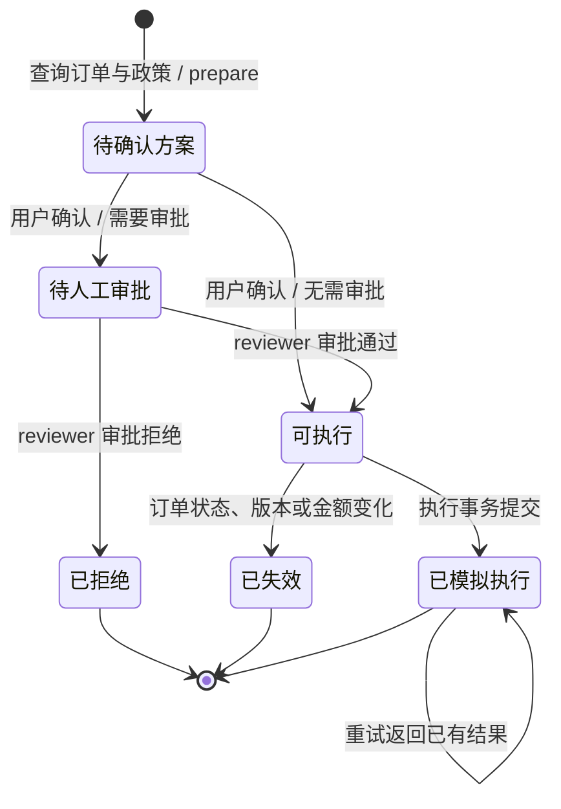

# 取消订单与模拟退款：受控工具执行

本模块把售后范围收敛为一条链路：查询本人订单 → 查询适用演示政策 → 生成待确认方案 → 用户确认 → 必要时人工审批 → 模拟取消与退款 → 查询最终状态。订单、政策快照、申请、审批、模拟执行结果和审计记录写入 SQLite；没有真实支付、资金划转或外部电商系统。

这是对现有客服系统的一条独立业务扩展。政策选择采用服务端的确定性规则与版本校验，**没有把本模块的政策查询宣称为向量 RAG，也没有完成或报告真实 LLM 的端到端评测提升**。原有 `/chat`、RAG 和 SaaS 回归基线仍有各自的统计口径，不能和这里的服务测试合并计算成功率。

## 服务边界

- 客户身份由服务端 Bearer token 映射得到；请求中的 `user_id`、自然语言自称和模型生成的参数都不能替代身份。
- LLM 仅用于理解、补问、解释，以及选择查询、准备方案或查询申请状态。创建申请的确认、人工审批和执行使用显式接口，由确定性代码校验。
- 用户确认绑定服务端生成的方案和确认 token。服务端校验所有权、确认方案有效期、幂等、审批、订单状态和快照中的审批阈值，不能靠模型自行遵守。
- 审批权限使用独立的 `reviewer` 角色。演示 token 用于本地验证；本模块没有实现用户注册、密码登录或生产身份管理。
- 模拟退款和订单取消在同一 SQLite 事务内提交。这里验证的是单库模拟副作用，不代表跨支付渠道的分布式事务或真实退款能力。
- 政策固定为演示 `v1`，数据库中的版本快照禁止更新和删除；本版不包含动态生效版本选择、多源政策冲突裁决或政策升级回归。
- 每个订单最多保留一条申请；`rejected` 或 `stale` 是本版的终态，尚未实现重新申请、撤销审批或部分退款。

## 状态图



“待确认方案”属于 quote 阶段，尚未创建售后申请；其余业务状态依次对应 `pending_approval`、`ready`、`rejected`、`succeeded` 和 `stale`。越权、未确认、缺少审批、确认方案过期和订单状态冲突应返回明确错误，不能产生取消或退款副作用。

## 离线演示

在仓库根目录运行：

```powershell
python SakikoMind/scripts/demo_aftersales.py --output aftersales-demo.json
```

该脚本仅使用 Python 标准库和售后核心服务，不依赖 Redis、ChromaDB、网络或模型 API。默认使用临时 SQLite，并在退出后清理；JSON 证据会保留。若要保留数据库，可指定一个新的路径：

```powershell
python SakikoMind/scripts/demo_aftersales.py --db .local/aftersales-demo.db --output .local/aftersales-demo.json
```

脚本拒绝使用已有非空数据库，避免旧状态影响演示；重新运行请改用新的数据库路径。输出中的 `simulated: true` 表示模拟业务环境，`model_calls: 0` 表示本次演示没有调用 LLM。演示输出包括初始订单、政策快照、重复确认返回同一申请、审批、提交后超时、状态查询恢复和执行重试证据，不记录确认 token。

演示种子包含：

| 用户 | 订单 | 金额（分） | 用途 |
| --- | --- | ---: | --- |
| alice | DEMO-1001 | 4900 | 低额正常链路 |
| alice | DEMO-1002 | 29900 | 需要人工审批的演示主链路 |
| alice | DEMO-1003 | 4900 | 已发货，不能按未发货取消流程处理 |
| bob | DEMO-2001 | 9900 | 跨用户权限测试 |

## 本地 API

进入 Python 服务目录并安装项目依赖后，显式配置演示身份和种子：

```powershell
cd SakikoMind
$env:AFTERSALES_TOKENS_JSON='{"alice-dev-token":{"user_id":"alice","role":"customer"},"reviewer-dev-token":{"user_id":"reviewer","role":"reviewer"}}'
$env:AFTERSALES_DB_PATH='data/aftersales/orders.db'
$env:AFTERSALES_DEMO_SEED='1'
python -m uvicorn api.aftersales:app --host 127.0.0.1 --port 8002
```

独立售后 API 不需要启动 Redis、ChromaDB 或配置真实模型。启用真实 LLM 对话需另行配置有效的 `ANTHROPIC_API_KEY`、`ANTHROPIC_BASE_URL` 和 `ANTHROPIC_MODEL`。`AFTERSALES_DEMO_SEED=1` 只用于显式开启本地演示数据；没有配置有效 token 时，不应开放匿名售后写操作。

所有售后请求都需携带 `Authorization: Bearer <token>`：

| 方法与路径 | 请求 / 用途 |
| --- | --- |
| `GET /aftersales/orders/{order_id}` | 查询有权访问的订单 |
| `POST /aftersales/quotes` | `order_id`, `reason`；生成含政策信息的待确认方案 |
| `POST /aftersales/applications` | `quote_id`, `confirmation_token`, `idempotency_key`, `confirmed: true`；显式确认并创建申请 |
| `GET /aftersales/applications/{application_id}` | 查询申请与已有执行结果 |
| `POST /aftersales/applications/{application_id}/review` | reviewer 提交 `approved`, `note` |
| `POST /aftersales/applications/{application_id}/execute` | 执行已满足前置条件的模拟操作 |
| `GET /aftersales/applications/{application_id}/audit` | 查询申请审计事件 |
| `POST /aftersales/chat` | `message` 以及可选 `order_id`, `application_id`；仅理解、补问与查询 / 准备方案 |

本专项 CI 独立运行售后应用。对于已挂载售后路由的主应用版本，通过 `/chat` 请求售后服务时需选择 `service: "aftersales"` 并携带同样的 Bearer 身份；兼容请求中的 `user_id` 不会赋予售后操作权限。模型对话不会自动替代用户确认、审批或执行接口。

示例查询：

```powershell
$headers = @{ Authorization = 'Bearer alice-dev-token' }
Invoke-RestMethod -Uri 'http://127.0.0.1:8002/aftersales/orders/DEMO-1002' -Headers $headers
```

## 提交后超时与恢复

离线演示在核心服务 `execute(..., fault="after_commit")` 的数据库事务提交之后注入 `TimeoutError`。该参数用于服务测试，不是公开 HTTP 执行接口的请求字段。

1. 调用方观察到超时，只能判断“响应未收到”，不能据此判断执行失败。
2. 用同一申请 ID 查询最终状态；`operation` 非空且 `status == "succeeded"` 时，可取得持久化操作 ID、金额和模拟标记。
3. 检查审计记录，确认审批与执行事实；再次执行同一申请时，应返回已有操作而非生成第二笔模拟退款。

执行提交前注入的超时会回滚事务，不应留下半完成订单或模拟退款。订单在确认后被发货、版本或金额改变时，执行会把申请记为 `stale` 并拒绝业务副作用；审批缺失同样不能执行。调用方应查询并解释停止原因。本版没有失效申请重新发起流程；上述恢复语义覆盖本地模拟环境，没有验证真实支付网关的超时或回调行为。

## 回归测试

进入 Python 服务目录运行隔离接口、写入准入及性能状态校验测试：

```powershell
cd SakikoMind
python -m pip install -r performance/requirements.txt
python -m pytest -q -c testing/api_regression/pytest.ini testing/api_regression/cases
python -m pytest -q tests/test_aftersales_write_admission.py tests/test_sqlite_write_comparison.py
```

测试范围围绕初始状态和最终业务状态定义，不能只验证回复中出现“成功”字样：

| 类型 | 核心断言 |
| --- | --- |
| 正常与审批链路 | 申请关联正确用户和订单；必要审批已记录；模拟执行结果持久化 |
| 越权 | 不可读写他人订单 / 申请；不能冒用 reviewer 身份 |
| 确认与幂等 | 未确认不创建申请；同键同请求返回同一申请；冲突参数不能复用同键 |
| 重复与并发执行 | 重试、重复请求及受控并发后仍只有一份有效模拟执行结果 |
| 订单状态竞争与快照 | 准备 / 确认后订单变化不能绕过校验；申请保留原政策版本与内容 |
| 故障恢复 | 提交后超时可以查询恢复；重试不重复改变业务状态 |
| 对话权限 | 模型或用户文本不能绕过确认、审批和执行限制 |

服务测试以隔离数据库运行；API 测试使用受控身份和模型替身。它们验证确定性业务约束与接入契约，**不等同于真实模型在多轮会话中的任务成功率**。最终覆盖范围以测试文件中的实际用例和运行结果为准。

## 评测与指标口径

未来开展真实 LLM 评测前，先冻结任务数据、初始数据库、政策版本、模型 / 提示词版本、最大轮数和故障注入点。调参任务与最终报告任务分开；每次 trial 重置环境，同一任务重复运行，并保留最终状态和完整工具轨迹。

| 指标 | 定义与必要说明 |
| --- | --- |
| 可执行任务成功率 | 合法可执行任务中，最终状态和必要确认 / 审批均正确的 trial 数 / 此类 trial 总数 |
| 正确拒绝率 | 应拒绝任务中，正确拒绝且无禁止副作用的 trial 数 / 应拒绝 trial 总数 |
| 非法状态变更 | 缺权限、确认、审批或合法状态时仍产生禁止变更的次数，同时报告对应 trial 数；观测为零不代表普遍无风险 |
| 错误拒绝 / 转人工率 | 本应可完成却被拒绝 / 无需审批却升级的 trial 数，分别除以对应合法任务数 |
| 完整任务 P95 耗时 | 从任务输入到最终结果的自动执行耗时 P95；单列是否排除人工等待、超时上限和失败任务 |
| 每个成功任务成本 | 同一报告范围内全部 trial 的模型费用（含失败尝试） / 成功 trial 数；成功数为零时标为不可计算 |

当前离线演示没有真实模型费用；不得据此宣称生产调用成本为零。专项测试的通过数、离线故障演示结果、真实模型 trial 的成功率和原有 RAG 检索指标需要分别报告。

RAG 的后续对照应在相同冻结问题集上，分别测试原始检索、重排、相邻证据补全和切块边界改进。固定其余因素或同步报告上下文预算变化，分别衡量适用证据是否完整、答案是否有依据、业务判断是否正确。该对照尚未由本次售后实现完成。
